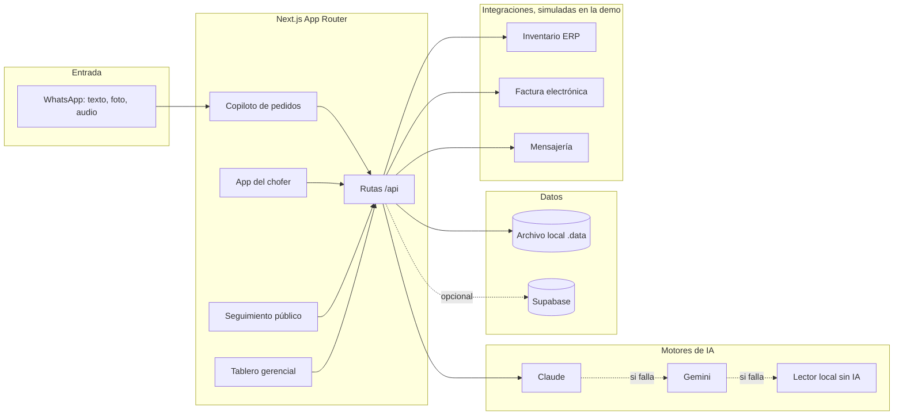

# Innova Track

Control de pedidos, despacho y entregas para distribuidoras y PyMEs de Costa Rica.

## Qué problema resuelve

Una distribuidora mediana recibe la mayoría de sus pedidos por WhatsApp: un mensaje mal escrito, la foto de una lista hecha a mano o una nota de voz. Alguien tiene que leerlos, digitarlos, revisar si hay inventario, facturar y avisar a bodega. Después el camión sale y gerencia se entera de lo que pasó cuando vuelve el chofer, con suerte con las facturas firmadas. Nadie sabe cuánto cuesta cada entrega, qué ruta recorre kilómetros de más ni qué cliente hace esperar una hora al camión.

Innova Track cubre ese recorrido completo. La IA convierte el mensaje, la foto o el audio en un pedido con cliente, productos y cantidades del catálogo. El pedido reserva inventario, se factura y se asigna a una ruta propia o a una mensajería externa. El chofer registra desde el teléfono el odómetro, la llegada a cada parada, la firma de recibido y los gastos. El cliente sigue su pedido con un enlace público. Gerencia ve el costo por kilómetro y por entrega, las desviaciones de ruta, las entregas fuera de horario y un estimado de ahorro anual con supuestos que puede ajustar.

Está pensado para dos tipos de empresa, y la demo trae una de cada una: una distribuidora con flotilla propia y una PyME que despacha con mensajería.

## Requisitos

- [Node.js](https://nodejs.org) 22 o superior (probado con Node 26 y npm 11). También funciona con [Bun](https://bun.sh).
- Git.
- Opcional: una llave de [Google AI Studio](https://aistudio.google.com/apikey) (Gemini) o de Anthropic (Claude) para leer fotos y audios.

## Instalación

```bash
git clone https://github.com/Andrescastrorodri/Innova-Track.git
cd Innova-Track
npm install
npm run dev
```

Abre <http://localhost:3000>. La primera vez se crean solos los datos de demostración en `.data/`.

Sin ninguna configuración la app ya funciona: los pedidos escritos se leen con el lector local sin IA. Para leer fotos, PDFs y notas de voz hace falta una llave:

```bash
cp .env.example .env.local
```

Abre `.env.local`, pon tu llave en `GEMINI_API_KEY` y reinicia `npm run dev`. En Windows PowerShell el primer comando es `Copy-Item .env.example .env.local`.

## Variables de entorno

Todas son opcionales. Van en `.env.local`, que git ignora.

| Variable | Para qué sirve | Valor por defecto |
| --- | --- | --- |
| `GEMINI_API_KEY` | Activa Gemini para leer pedidos (texto, foto, PDF, audio) y generar las alertas de gerencia. | Sin llave: lector local |
| `ANTHROPIC_API_KEY` | Activa Claude. Si está, se usa antes que Gemini. No recibe audio: las notas de voz van a Gemini. | Sin llave |
| `GEMINI_MODEL` | Modelo de Gemini. | `gemini-3.5-flash-lite` |
| `ANTHROPIC_MODEL` | Modelo de Claude. | `claude-opus-5-5` |
| `AI_TIMEOUT_MS` | Tiempo máximo por llamada a la IA. Al pasarse, se usa el siguiente motor. | `20000` |
| `NEXT_PUBLIC_SUPABASE_URL`, `NEXT_PUBLIC_SUPABASE_ANON_KEY`, `SUPABASE_SERVICE_ROLE_KEY` | Base de datos para desplegar. Ver [Despliegue](#despliegue). | Sin ellas: archivo local |
| `ERP_INVENTORY_WEBHOOK_URL`, `INVOICING_API_URL`, `EXTERNAL_COURIER_API_URL` | Servicios reales de inventario, factura electrónica y mensajería. | Modo demostración |
| `PORT` | Puerto de `npm run dev`. | `3000` |

Orden de los motores de IA: Claude, luego Gemini, luego el lector local. Si uno falla, tarda de más o responde algo que no pasa la validación, se usa el siguiente, y la pantalla indica cuál leyó el pedido.

## Cómo correr la demo

| Pantalla | Dirección |
| --- | --- |
| Inicio | `/` |
| Copiloto de pedidos | `/pedidos/nuevo` |
| App del chofer | `/chofer` |
| Tablero gerencial | `/gerente` |
| Seguimiento público | `/tracking/IT-9101` |
| Configuración | `/configuracion` |

Los datos iniciales traen dos semanas de operación que terminan ayer y tres pedidos de hoy esperando ruta (`IT-9101` a `IT-9103`), para que el chofer tenga carga desde el primer momento. En `docs/demo/` hay una foto de un pedido manuscrito y una nota de voz para probar la captura.

Recorrido sugerido:

1. En `/pedidos/nuevo`, pega un mensaje de WhatsApp o adjunta la foto. Revisa el pedido, confirma, factura y despacha.
2. En `/chofer`, elige la ruta de la zona del cliente, inicia la ruta, marca llegada, toma la firma, registra un gasto y cierra.
3. Abre el enlace de seguimiento del pedido.
4. En `/gerente`, revisa la sección Impacto y pulsa "Analizar operación".

### Reiniciar la demo

Para volver al estado inicial entre una presentación y otra:

```bash
npm run demo:reset
```

O el botón "Reiniciar demo" en `/configuracion`. Restaura los datos y borra las firmas y fotos generadas.

### Qué está simulado

La factura electrónica, la reserva en el ERP y la cotización de mensajería funcionan en modo demostración: generan datos con el formato real (por ejemplo, una clave de Hacienda de 50 dígitos) pero no se envían a ningún servicio. En pantalla llevan la etiqueta "Modo demostración". Al configurar las URL reales en `.env.local`, la app envía ahí cada operación.

## Despliegue

El almacén en archivo (`.data/`) sirve para la demo local, pero **no persiste en Vercel** ni en otros servicios sin disco: cada petición puede caer en una instancia distinta y los datos se pierden. Hay dos opciones.

**Opción 1: demo local (recomendada para presentar).** `npm run dev` en la computadora de la presentación. No depende de nada externo salvo la llave de IA, y sin internet sigue funcionando con el lector local.

**Opción 2: despliegue con Supabase.**

1. Crea un proyecto en [Supabase](https://supabase.com).
2. En el editor SQL, ejecuta el contenido de `supabase/schema.sql`. Crea las tablas, las vistas y el bucket `evidencias`, y activa Row Level Security.
3. Copia la URL y las llaves del proyecto a `.env.local`.
4. Carga los datos de demostración: `npm run seed` (usa `npm run seed -- --dry-run` para ver antes qué se cargaría).
5. Configura las mismas variables en el servicio donde despliegues.

Estado actual de esta opción: la lectura del tablero, el seguimiento y la configuración usan Supabase, pero crear pedidos, despachar y el flujo del chofer todavía leen del archivo local. Hasta que eso se complete, un despliegue con Supabase sirve para mostrar indicadores, no para operar. El botón "Reiniciar demo" solo afecta el archivo local.

## Arquitectura



| Carpeta | Contenido |
| --- | --- |
| `src/app` | Páginas y rutas de API |
| `src/components` | Pantallas: copiloto, chofer, tablero, seguimiento, configuración |
| `src/lib/ai` | Motores de IA: selección, salida estructurada, validación y respaldo |
| `src/lib/order-matching.ts` | Lector de pedidos sin IA y relación con catálogo y clientes |
| `src/lib/analytics.ts`, `src/lib/impact.ts` | Indicadores y cálculo de ahorro |
| `src/lib/data-store.ts`, `src/lib/seed-data.ts` | Almacén y datos de demostración |
| `supabase/schema.sql` | Esquema de base de datos |
| `DESIGN.md` | Sistema visual |

## Comandos

| Comando | Qué hace |
| --- | --- |
| `npm run dev` | Servidor de desarrollo |
| `npm run build` y `npm start` | Compilación y servidor de producción |
| `npm run lint` | Revisión de tipos |
| `npm test` | Pruebas |
| `npm run demo:reset` | Restaura los datos de demostración |
| `npm run seed` | Carga los datos de demostración en Supabase |

## Seguridad

- Las llaves van solo en `.env.local`. No las pegues en el código, en capturas ni en chats.
- La app no tiene inicio de sesión: cualquiera con la dirección puede usarla. No la publiques con datos reales sin agregar autenticación.
